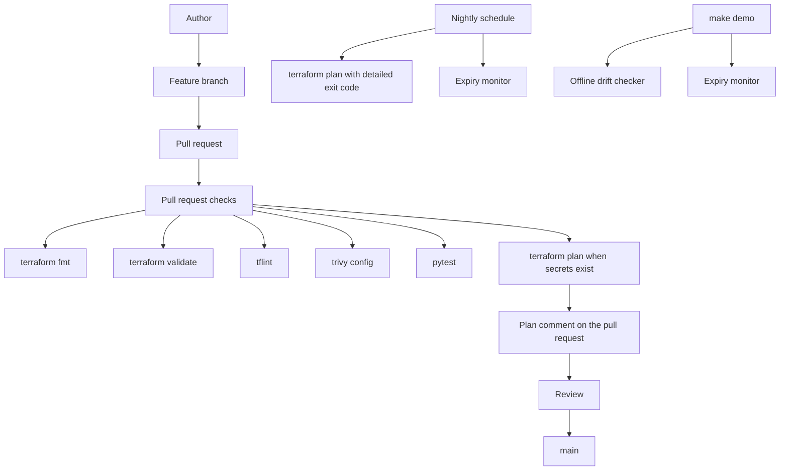

# Architecture

This lab keeps identity configuration in git and reviews it like any other change. Two Terraform roots describe the lab directory. Python tools check drift and expiry without a tenant. A small admin script shows the dry-run pattern used for membership edits.

Nothing in CI applies a change. Apply stays on a workstation, after review, and only when you have pointed the provider at a tenant you control.

## Flow

## Terraform

| Stack | Path | What it manages |
| --- | --- | --- |
| Okta | `terraform/okta/environments/lab` | Groups, group rules, a SAML app, group assignments, and a sign-on policy |
| Entra | `terraform/entra/environments/lab` | Security groups, a report-only conditional access policy, and an app registration |

Each root is thin. Resources live in modules under `terraform/okta/modules` and `terraform/entra/modules`. The lab values sit in `terraform.tfvars.example`. Tokens and client secrets are variables with no default and are marked sensitive.

The Entra conditional access state is a literal, `enabledForReportingButNotEnforced`. Changing enforcement means editing the module.

Provider lock files are committed so CI and a workstation resolve the same builds.

## Drift

Two checks, on purpose:

1. `terraform plan -detailed-exitcode` on a schedule, only when tenant secrets exist. Exit code 2 means the config and the state differ. A hosted runner has empty local state unless you configure a remote backend, so read [the drift runbook](runbooks/respond-to-drift-alert.md) before treating that plan as tenant drift.
2. `tools/drift/checker.py`, which is fully offline. It normalizes a desired-state YAML file and a JSON export into the same shape, then diffs groups, rules, apps, assignments, and policies. `tools/drift/samples/live-export.json` is a mock with deliberate drift. It is not a tenant export.

The live JSON uses short names taken from API payloads (`groupRules`, `signOnMode`, `conditionalAccessPolicies`). The checker maps those onto the desired-state names (`rules`, `sign_on`, `policies`). A real export has to be translated into that JSON shape before the checker will accept it. The checker does not log into anything.

## Expiry

`tools/expiry-monitor/monitor.py` reads `tools/expiry-monitor/inventory/lab.yaml`.

| Kind | How the date is read |
| --- | --- |
| `saml_signing` | PEM file, or the earliest certificate in SAML metadata XML |
| `ssl` | PEM file, or a live TLS read when `live_check` is true |
| `apple_push` | `not_after` in the inventory |
| `wifi` | PEM file for an 802.1X certificate |
| domain | `expires_on` in the inventory |

Thresholds are 60 days (notice), 30 days (warning), and 7 days (critical). A date in the past is expired. The process exits non-zero when any row is critical, expired, or an error.

The live TLS read turns verification off so a self-signed or already expired lab certificate can still be dated. It is not a trust decision, and the sample inventory leaves `live_check` false so `make demo` stays offline.

The committed certificates are public lab material generated by `tools/expiry-monitor/generate_fixtures.py`. Private keys are not stored.

## Admin script

`scripts/preview_group_changes.py` and `scripts/Preview-GroupChanges.ps1` diff a desired membership file against a JSON directory export. Dry-run is the default. Apply writes another local JSON file. See [scripts/README.md](../scripts/README.md).

## What is outside this repo

- A real Okta org or Entra tenant. Optional, and only through environment variables. Setup notes: [okta-dev-setup.md](okta-dev-setup.md), [entra-setup.md](entra-setup.md).
- Remote Terraform state. Local state is the default.
- Applying plans. CI never runs `terraform apply`.
